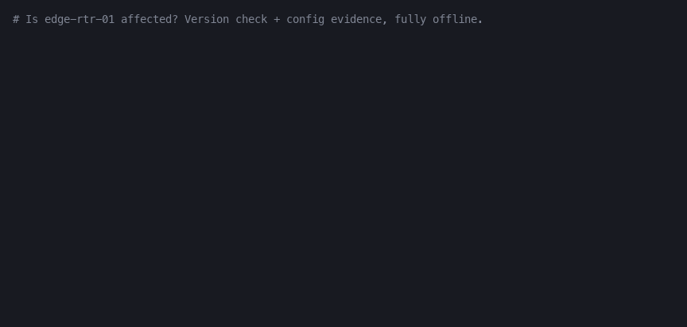
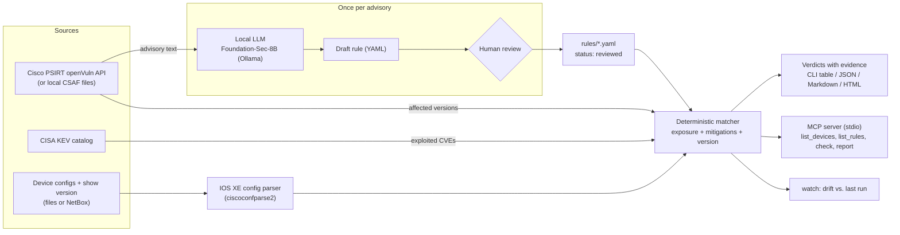

# netsec-check

**Am I actually affected?** Match Cisco PSIRT security advisories against your real device
configurations and get a verdict per device, with evidence. Works as a CLI and as an MCP server for
AI assistants.

[](https://github.com/faithere1/netsec-check-mcp/actions/workflows/ci.yml)
[](LICENSE)



> Status: pre-1.0. Cisco IOS XE only, with 10 reviewed rules. All sample data in this repository is
> fake.

## The problem

The Cisco PSIRT openVuln API tells you which software versions are affected and which are fixed.
It does not tell you whether the vulnerable *feature* is enabled on your device. Many advisories only
apply when a specific feature is configured (for example `ip http server`). Cisco no longer publishes
OVAL definitions, so engineers still read every advisory and check every device by hand with `show`
commands.

## How netsec-check works

1. **Collect**: pull advisories from the PSIRT openVuln API and devices from config files or NetBox.
2. **Extract**: a security LLM (Cisco Foundation-Sec, run locally) reads the advisory once and turns
   the "vulnerable only if..." condition into a structured, human-reviewable YAML rule.
3. **Match**: a deterministic engine evaluates each rule against each device's version and config.
   No LLM runs per device.
4. **Report**: every device gets one verdict, ranked by active exploitation (CISA KEV):

| Verdict | Meaning |
|---------|---------|
| `AFFECTED` | Vulnerable version and the vulnerable feature is enabled |
| `NOT_AFFECTED_FEATURE_DISABLED` | Vulnerable version, but the feature is not enabled |
| `FIXED_VERSION` | Running a fixed release |
| `MITIGATED` | Vulnerable, but the advisory's workaround is applied |
| `INDETERMINATE` | Needs runtime data; the exact `show` command is listed |

Each verdict cites the advisory sentence and the config lines it was based on.

## Architecture



The LLM only turns advisory text into a rule, once, and a human reviews the rule before `check`
uses it. Per-device matching has no LLM in the loop: the same inputs always give the same verdicts.
Configs never leave the host; in live mode only software versions are sent to Cisco.

## Quick start (offline)

Requirements: Python 3.11+ and [uv](https://docs.astral.sh/uv/). No account or API key is needed
for offline mode.

```bash
git clone https://github.com/faithere1/netsec-check-mcp
cd netsec-check-mcp
uv sync
uv run netsec-check check --offline --evidence                # all sample devices x all rules
uv run netsec-check check --offline --device edge-rtr-01 --format json
```

Offline mode reads `rules/` and `samples/configs/<hostname>/{running-config,show-version}.txt`.
Version status comes from the local CSAF files in `tests/fixtures/psirt/` (`--advisories DIR`):
a version listed as `known_affected` for "Cisco IOS XE Software" is affected; an unlisted version
is fixed if its release train is listed or newer than every listed train; an older, unlisted
train (Cisco does not evaluate releases past end of maintenance) is `INDETERMINATE`.
Secrets (SNMP communities, passwords, keys) are redacted in the evidence lines.

## Live mode (openVuln + CISA KEV)

```bash
cp .env.example .env        # then fill in CISCO_CLIENT_ID / CISCO_CLIENT_SECRET
uv run netsec-check check --evidence
```

Without `--offline`, `check` asks the PSIRT openVuln API (OAuth2 client credentials from a
[Cisco API Console](https://apiconsole.cisco.com) app) which advisories affect each device's IOS XE
version, one request per distinct version, and flags rule CVEs that are in the
[CISA KEV catalog](https://www.cisa.gov/known-exploited-vulnerabilities-catalog) (`KEV` column).
Mix sources with `--versions openvuln|csaf|none` and `--kev cisa|none|FILE`.
Only software versions are sent to Cisco; configs never leave the host.

Live smoke tests are opt-in: `NETSEC_LIVE=1 uv run pytest -m live`.

## NetBox inventory

`check --netbox` reads devices from NetBox instead of `--configs`: the device type's part number
(or model) is the PID, and two custom fields on devices hold the data that `show version` and the
config files provide in file mode: `software_version` (text) and `running_config` (long text).
Set `NETBOX_URL` and `NETBOX_TOKEN` in `.env`; v1 (`Token`) and v2 (`nbt_…`, `Bearer`) tokens
both work. Narrow the device query with `--netbox-filter KEY=VALUE` (any NetBox device filter,
repeatable).

A local lab with the sample devices (needs Docker, e.g. `brew install colima docker
docker-compose && colima start`):

```bash
uv run python -m netsec_check.netbox.secrets >> .env   # random lab passwords + API token
docker compose --env-file .env -f netbox/docker-compose.yml up -d --wait
uv run netsec-check netbox-seed                         # idempotent
uv run netsec-check check --offline --netbox --netbox-filter site=netsec-lab
```

NetBox runs on http://127.0.0.1:8000 (user `admin`, password `NETBOX_SUPERUSER_PASSWORD`).
The compose file is a trimmed copy of
[netbox-docker](https://github.com/netbox-community/netbox-docker); `--offline` still allows
`--netbox`, because it only concerns advisory and KEV sources.

## Reports

```bash
uv run netsec-check check --offline --format markdown --output report.md
uv run netsec-check check --offline --format html --output report.html
```

A report has a verdict summary, a per-device table and one section per `AFFECTED`,
`INDETERMINATE` or `MITIGATED` result: the advisory link and CVEs, CISA KEV dates, the reason, the
redacted evidence lines, the `show` commands that confirm runtime facts, and the fix. Besides
"upgrade to a fixed release", rules can carry IOS XE config snippets: `mitigations[].snippet`
applies the advisory's workaround, `remediation.snippet` removes the exposure (for example
`no vstack` or `no ip http server`). `<name>` marks a value to fill in. The HTML file is
self-contained (no scripts, no external assets).

## MCP server

`netsec-check mcp` runs a [Model Context Protocol](https://modelcontextprotocol.io) server over
stdio (official `mcp` Python SDK), so an AI assistant can ask "which of my devices are affected?"
and get deterministic verdicts with evidence.

| Tool | Purpose |
|------|---------|
| `list_devices` | Inventory devices with PID and version (`inventory`: `files` or `netbox`) |
| `list_rules` | Reviewed rules: advisory, CVEs, title, exposure summary |
| `check` | One verdict per device and rule, with reason, evidence, runtime checks, KEV |
| `report` | The Markdown or HTML report described above |

Resource template `netsec://rules/{rule_id}` returns a rule as YAML. Tools accept device and
rule names, never file paths; the directories are fixed at start-up (`--configs`, `--rules`,
`--advisories`, `--env-file`). Defaults are offline (`versions="csaf"`, `kev="none"`); a client
must ask for `versions="openvuln"`, `kev="cisa"` or `inventory="netbox"` explicitly.

Client configuration (Claude Desktop, Claude Code `.mcp.json`, Cursor, ...):

```json
{
  "mcpServers": {
    "netsec-check": {
      "command": "uv",
      "args": ["run", "--directory", "/path/to/netsec-check-mcp", "netsec-check", "mcp"]
    }
  }
}
```

Try it with [MCP Inspector](https://github.com/modelcontextprotocol/inspector):

```bash
npx @modelcontextprotocol/inspector uv run --directory "$PWD" netsec-check mcp
npx @modelcontextprotocol/inspector --cli uv run --directory "$PWD" netsec-check mcp \
  --method tools/call --tool-name check --tool-arg only_findings=true
```

## Drift watch

`watch` re-runs `check` (same source options) and compares the result with the snapshot of the
previous run, so new exposure from a config change, a new device, updated advisory or version
data, or a new KEV listing shows up as a change:

```bash
uv run netsec-check watch --offline                     # first run saves the baseline
uv run netsec-check watch --offline                     # later runs print the changes
uv run netsec-check watch --interval 3600 --count 24    # hourly for a day (live sources)
```

The snapshot lives in `.netsec-check/watch-state.json` (`--state`, gitignored) and holds only
verdicts, exposure, mitigation ids, KEV CVEs and redacted evidence text (no line numbers, so an
unrelated edit higher up in a config is not reported). Change kinds: `new`, `gone`, `verdict`,
`evidence`, `kev`. `--format json` prints machine-readable changes. Exit code: 0 no drift,
1 drift in any run (for cron or CI), 2 setup or state-file error.

## Draft rules with an LLM

`netsec-check extract` turns advisory text into a `draft` rule. The model reply is constrained by
the rule JSON Schema and then validated like a hand-written rule; invalid replies are retried with
the validation error. Advisory IDs, CVEs and titles are copied from the advisory, never generated.

Default backend: Foundation-Sec-8B-Instruct on a local Ollama (advisories stay on the host).

```bash
ollama pull hf.co/fdtn-ai/Foundation-Sec-1.1-8B-Instruct-Q4_K_M-GGUF
ollama create foundation-sec-8b-instruct -f ollama/foundation-sec-8b-instruct.Modelfile
uv run netsec-check extract                           # all fixture advisories -> eval/<model>/rules/
uv run netsec-check eval-extraction --drafts eval/ollama-foundation-sec-8b-instruct/rules
```

The Modelfile adds the chat template that the published GGUF lacks; without it the system prompt
is dropped. Any OpenAI-compatible server works too (key read from `OPENAI_API_KEY`):

```bash
uv run netsec-check extract --backend openai --model <name> --base-url http://localhost:8000/v1
```

Drafts are written under `eval/`, not `rules/`, so `check` ignores them until a human reviews
one, sets `status: reviewed` and moves it into `rules/`.
`eval-extraction` runs drafts and hand rules through the same matcher on the sample devices and
writes `report.md` / `report.json` next to the drafts.

## Evaluation

`uv run netsec-check eval-golden` scores final verdicts on 60 held-out advisory×config pairs
(`eval/golden/`); see [eval/README.md](eval/README.md) for the metrics table and caveats.

## Limitations

- Cisco IOS XE only; NX-OS and ASA are not supported yet (the parser and rule interfaces are kept
  platform-agnostic).
- Only advisories with a rule in `rules/` get a config-level verdict (10 today). Other openVuln
  advisories for a device's version are not reported yet.
- Some facts cannot be read from a config (active L2TP tunnels, UDP 500 reachable, IOx running);
  those results are `INDETERMINATE` and list the `show` command to run.
- The golden labels were written by the rule author, so the 60/60 score in
  [eval/README.md](eval/README.md) is an upper bound. Independent labels are very welcome.
- LLM drafts from Foundation-Sec-8B are not good enough to use unreviewed (see the eval report);
  that is why every rule needs `status: reviewed`.
- No client-side throttling for the openVuln API yet; keep long `watch --interval` runs modest.
- netsec-check never logs in to devices. Treat its output as triage, not a guarantee; confirm
  with Cisco's advisory and the Cisco Software Checker.

## Development

```bash
uv sync
uv run ruff check . && uv run ruff format --check . && uv run mypy && uv run pytest
uv run --with pillow python scripts/demo_gif.py          # regenerate docs/demo.gif
```

Copy `.env.example` to `.env` and add your free Cisco API Console credentials to use the live
PSIRT API.

## Contributing and getting help

- New rules and fixes: see [CONTRIBUTING.md](CONTRIBUTING.md).
- Questions, wrong verdicts and feature requests: open a
  [GitHub issue](https://github.com/faithere1/netsec-check-mcp/issues) (fake configs only).
- Security problems in netsec-check: see [SECURITY.md](SECURITY.md).

## Credits

- Advisory data: [Cisco PSIRT openVuln API](https://developer.cisco.com/psirt/) and public CSAF
  documents; exploited-vulnerability data: [CISA KEV](https://www.cisa.gov/known-exploited-vulnerabilities-catalog).
- Config parsing: [ciscoconfparse2](https://github.com/mpenning/ciscoconfparse2).
- Local LLM: [Foundation-Sec-8B-Instruct](https://huggingface.co/fdtn-ai/Foundation-Sec-8B-Instruct)
  via [Ollama](https://ollama.com).
- MCP: the official [Model Context Protocol Python SDK](https://github.com/modelcontextprotocol/python-sdk).
- NetBox lab: trimmed from [netbox-docker](https://github.com/netbox-community/netbox-docker).

Not affiliated with or endorsed by Cisco Systems.

## License

[Apache-2.0](LICENSE)
